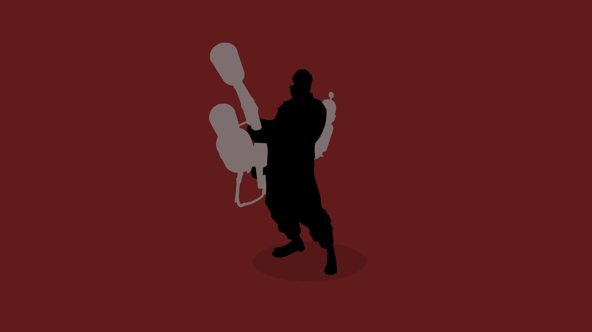

Dodgeball is a community-made Team Fortress 2 mode where everyone plays Pyro and uses the airblast (right mouse button) to deflect homing rockets back at the other team. The rocket speeds up with every deflection, whoever fails to deflect it loses, and the last team standing wins. We already have a Dodgeball server online: see how to join at the end of this post.

*Pyro is the only class in Dodgeball.*

## What Dodgeball is

In Dodgeball, nobody attacks anyone directly. The only "weapon" in the match is a homing rocket that chases a player on the opposing team. That player has to deflect the rocket with the airblast and send it back, so the rocket bounces between the teams. It gets faster with each deflection until someone misses the timing and gets hit. The last team standing wins.

## How it started

The mode was born in the community itself, and the facts below come from the [Team Fortress Wiki](https://wiki.teamfortress.com/wiki/Dodgeball):

- It started as a private extension by Voogru.
- Asherkin converted it to SourceMod in 2010.
- Damizean's rewrite, also from 2010, became the most popular version ever since.
- Maps for the mode use the `tfdb_` prefix.

Our server runs a modern, maintained version of the plugin, descended from Damizean's.

## How to play

- **Aim at the rocket and deflect it at the right moment.** The airblast only works when the rocket is close, so pressing the button too early doesn't help.
- **Remember the rocket chases a player on the opposing team.** When it's coming for you, get ready to deflect. When it's heading for a teammate, stay out of the way.
- **The more deflections, the faster it goes.** The pace keeps climbing, so the calm at the start of a round doesn't last.
- **Keep moving, don't stand still.** Walking, jumping and adjusting your position helps you track the rocket and deflect more precisely.
- **Watch out for the Nuke.** About 10% of rockets are "Nukes": slower, stronger and with an area explosion, with a shockwave. They give you more time to react, but whoever misses takes more damage.
- **Check the speedometer.** An on-screen meter shows the rocket's speed and helps you feel when to deflect.

If you're just starting out: play it calm, focus only on deflecting, and leave speed for later. In time you'll pick up the advanced techniques the wiki mentions, like orbiting, cutting and surprise target switching.

## What our server is like

- **Name:** SKYNET BRASIL - DODGEBALL [100 TICK]
- **Capacity and network:** 16 slots, 100 tick, hosted in São Paulo
- **Online since:** 10/06/2026
- **Pyro only:** your class is picked automatically when you join a team.
- **10 maps:** `tfdb_amazon_b1`, `tfdb_backyard`, `tfdb_baseball`, `tfdb_blockland_v4_1`, `tfdb_hellspawn_b2`, `tfdb_indoor_tennis_b1a`, `tfdb_pacmen_a4`, `tfdb_risky_heights_v2`, `tfdb_rocketbucks_v2` and `tfdb_toolsheds_b4`. Maps download automatically the first time you join.
- **Map vote:** each map lasts 20 minutes. With 3 minutes left, a vote between 3 maps opens.
- **Homing rockets:** they speed up with every deflection, and about 10% are "Nukes".
- **Its own ranking**, separate from the main server. Everyone starts at 1000 points: +1 per kill, -1 per death and +2 for every player on the team that wins the round. It only counts with 4 or more players on the server. Chat commands are the same: `rank`, `top10`, `session` and `place`.
- **Same staff:** SourceBans, admins, rules and `!report` are the same on both servers, and a ban applies on both.

## How to join

Open the game console and type:

`connect 212.38.89.226:27025`

Or jump straight in, with TF2 already connected:

<a class="btn btn-gold" href="steam://connect/212.38.89.226:27025">Play now</a>

Check your position on the [Dodgeball ranking](https://stats.skynet-tf2.com.br/hlstats.php?game=tfdb).
