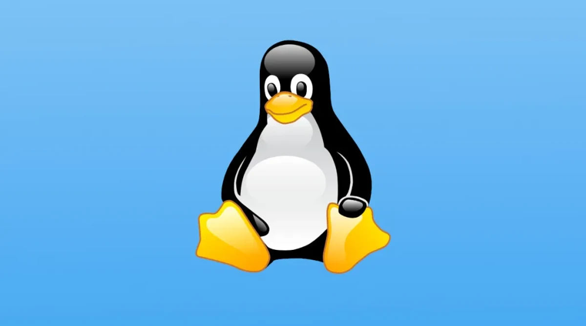

Se você joga online, quase com certeza já usou o Linux sem perceber: ele roda em uma enorme parte dos servidores da internet, e também dentro de celulares Android e de muitos aparelhos do dia a dia. Neste guia explicamos, do zero, o que é o Linux, de onde ele veio, como usá-lo e por que ele é a escolha número um para servidores, inclusive os nossos.

## O que é open source e software livre

**Código aberto (open source)** é o software cujo código-fonte, isto é, a "receita" do programa, pode ser lido, estudado, modificado e compartilhado por qualquer pessoa, seguindo uma licença.

**Software livre** é a ideia mais antiga por trás disso, defendida pela Free Software Foundation. Para ela, o usuário tem quatro liberdades: **executar** o programa para qualquer fim, **estudar** como ele funciona e adaptá-lo, **redistribuir** cópias e **melhorar** o programa e compartilhar as melhorias. Os dois termos se sobrepõem bastante, mas o foco muda: "software livre" fala de liberdade; "open source" fala mais das vantagens práticas de um desenvolvimento aberto.

Atenção: "livre" não significa necessariamente "grátis". Muito software livre é gratuito, mas a palavra se refere à liberdade, não ao preço.

## A história: GNU e Linux

- **1983:** Richard Stallman anuncia o **projeto GNU**, com o objetivo de criar um sistema operacional completo e livre, semelhante ao Unix. Em poucos anos o GNU tinha compilador, editores, ferramentas de terminal e muito mais. Faltava uma peça central: o kernel.
- **1991:** o estudante finlandês **Linus Torvalds** começa a escrever um kernel como projeto pessoal e o anuncia na internet. Esse kernel recebe o nome **Linux**. Pessoas do mundo todo passam a contribuir, e o projeto cresce até hoje.

Juntando as ferramentas do GNU com o kernel Linux, nasceu um sistema operacional livre e completo.

## O que é o kernel e por que se fala "GNU/Linux"

O **kernel** é o "coração" do sistema operacional: é ele que conversa com o hardware (processador, memória, disco, rede) e entrega esses recursos aos programas. Sem um kernel, nenhum programa consegue usar a máquina.

Tecnicamente, **Linux é só o kernel**. O sistema que usamos no dia a dia é o kernel somado a muitas ferramentas, em grande parte vindas do projeto GNU. Por isso algumas pessoas e projetos preferem dizer **GNU/Linux**, reconhecendo as duas partes. Na conversa comum, a maioria diz apenas "Linux" para o conjunto.

## Distribuições: qual escolher?

Uma **distribuição** (ou "distro") é o kernel Linux empacotado com programas, instalador e um sistema para atualizar tudo. Todas usam o mesmo kernel, mas cada uma tem um perfil:

- **Debian:** conhecido pela estabilidade e pela filosofia livre. É a base de muitas outras distribuições, e muito usado em servidores.
- **Ubuntu:** baseado no Debian, com foco em facilidade de uso. É uma das distribuições mais populares, tanto em desktops quanto em servidores.
- **Fedora:** traz tecnologias novas cedo e é patrocinado pela Red Hat. Bom para quem gosta de novidades.
- **Arch Linux:** minimalista e sob medida: você monta o sistema do jeito que quer, com atualizações contínuas. Pede mais conhecimento.
- **Outras:** Linux Mint (muito amigável para iniciantes), openSUSE, Red Hat Enterprise Linux e seus derivados (muito usados em empresas), Alpine (leve, comum em containers) e muitas mais.

Para começar, Ubuntu e Linux Mint costumam ser as escolhas mais tranquilas.

## A linha de comando

Além das janelas e dos menus, o Linux pode ser controlado por texto, no **terminal**. Em servidores, essa é a forma principal de trabalhar: é rápida, precisa e fácil de automatizar. Alguns comandos básicos:

| Comando | Para que serve |
|---|---|
| `pwd` | Mostra em qual pasta você está. |
| `ls` | Lista os arquivos da pasta atual. |
| `cd pasta` | Entra em uma pasta (`cd ..` volta uma). |
| `mkdir nome` | Cria uma pasta. |
| `cp origem destino` | Copia um arquivo. |
| `mv origem destino` | Move ou renomeia um arquivo. |
| `cat arquivo` | Mostra o conteúdo de um arquivo. |
| `grep texto arquivo` | Procura um texto dentro de um arquivo. |
| `sudo comando` | Executa o comando com permissões de administrador. |
| `man comando` | Abre o manual de qualquer comando. |

Um aviso importante: comandos como `rm` apagam arquivos **sem passar pela lixeira**, e `sudo` dá poder total. Leia com atenção antes de executar algo que você não entende.

## Por que o Linux domina os servidores

- **Estabilidade:** servidores Linux costumam ficar ligados por longos períodos, e a maioria das atualizações não exige reiniciar a máquina inteira.
- **Segurança:** o código aberto pode ser revisado por muita gente, e o sistema tem um modelo de permissões bem definido. Correções costumam sair rápido.
- **Custo:** o sistema não tem licença paga, o que faz diferença quando se tem dezenas ou milhares de servidores.
- **Desempenho:** ele pode ser enxuto e ajustado para usar bem o hardware, sem programas desnecessários rodando.
- **Automação:** quase tudo no Linux pode ser feito por linha de comando, então é fácil escrever scripts e automatizar tarefas.
- **Containers:** tecnologias como o Docker nasceram em torno de recursos do kernel Linux, e hoje são a base de como muitas aplicações são publicadas.
- **Nuvem:** a imensa maioria dos serviços de nuvem pública roda Linux por baixo.
- **Supercomputadores:** os computadores mais potentes do mundo, listados no ranking TOP500, rodam Linux há anos.

## O Linux na SKYNET

E onde entramos nessa história? **Os nossos servidores rodam em Linux, com Docker**: uma VPS com Ubuntu, um container para cada servidor de jogo, backups automáticos e reinícios agendados. Tudo isso é possível graças a software livre. Se quiser ver na prática como montamos cada peça, leia o post [Como funcionam os servidores SKYNET por dentro](/blog/como-funcionam-os-servidores-skynet/).

Depois, que tal testar o resultado? Veja o [ranking da SKYNET](https://stats.skynet-tf2.com.br/hlstats.php), confira o [SourceBans](https://bans.skynet-tf2.com.br/index.php?p=home) e entre em um dos nossos servidores.
