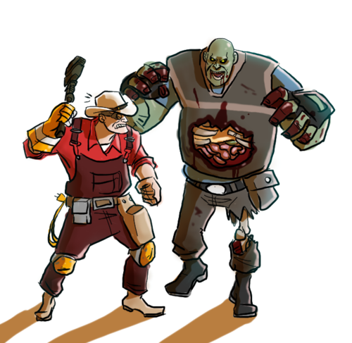
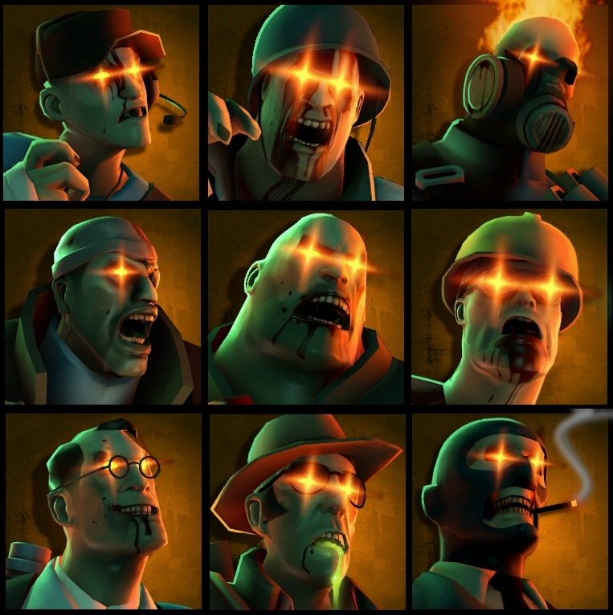

Zombie Infection é o modo de zumbis oficial do Team Fortress 2: todo mundo começa como sobrevivente no time RED, alguns jogadores viram zumbi no BLU, e quem morre também vira zumbi. Os zumbis vencem se infectarem todo mundo, e os sobreviventes vencem se aguentarem até o tempo acabar. Já temos um servidor de Zombie Infection no ar: confira como entrar no fim do post.

## O que é Zombie Infection

Cada partida começa com todos no RED e um tempo de preparação. Quando ele termina, alguns jogadores são sorteados para virar zumbi: de 1 a 5, conforme o número de jogadores. Quem morre no RED vira zumbi no BLU, então a horda só cresce. Cada infecção soma 8 segundos ao relógio, e o RED vence se algum sobrevivente aguentar até o tempo acabar.

Para equilibrar a partida, quando sobram 3 sobreviventes eles passam a causar mini-crits, e o último sobrevivente causa críticos.

## Como surgiu

Os fatos abaixo vêm da [Team Fortress Wiki](https://wiki.teamfortress.com/wiki/Zombie_Infection):

- O modo foi feito pela comunidade em VScript e adicionado oficialmente pela Valve no evento de Halloween Scream Fortress XV, em outubro de 2023.
- Antes dele, os modos de zumbi do TF2 existiam como plugins de servidor da comunidade, como o Zombie Fortress.
- Em outubro de 2024 o modo ganhou o mapa `zi_blazehattan`, e os times passaram a se chamar Survivors (RED) e Zombies (BLU).

## Como jogar

*Sobreviver depende de trabalho em equipe.*

**Dicas para o sobrevivente**

- **Fique perto do time.** Quem anda sozinho vira a primeira infecção.
- **Use as construções.** As sentinelas causam 60% menos dano nos zumbis, e a minigun do Heavy causa 40% menos, então não conte só com elas.
- **Escolha bem a arma.** A Pomson 6000 põe a habilidade do zumbi em recarga por 3 segundos, e o Homewrecker destrói a granada EMP do Spy.
- **Desconfie do Spy.** O Spy sobrevivente também pode se disfarçar de zumbi.

**Dicas para o zumbi**

- **Use a sua habilidade.** Cada classe tem uma, e a recarga é curta: veja a lista logo abaixo.
- **Ataque em grupo.** O Medic zumbi cura os aliados, e o Engineer zumbi cria um ponto de renascimento perto da ação.
- **Cada infecção conta.** Ela soma 8 segundos ao relógio e põe mais um zumbi na partida.

## Habilidades dos zumbis

*As 9 classes viram zumbi, cada uma com sua habilidade.*

- **Scout, Speed Demon:** passiva. 75% mais rápido, pulo 25% mais alto, pulo triplo e 75 de vida.
- **Soldier, Pounce:** salta para a frente, e cair na cabeça de alguém dá um stomp. Recarga de 5 s.
- **Pyro, Sticky Spew:** cospe piche que atrapalha as armas de mobilidade dos sobreviventes. É imune a líquidos e explode ao morrer. Recarga de 10 s.
- **Demoman, Blast Charge:** explosão de 275 de dano ao redor. Recarga de 6 s.
- **Heavy, Rock Hurl:** arremessa concreto que atordoa no acerto direto, empurra e desativa construções. Recarga de 10 s.
- **Engineer, Beacon:** cria um ponto de renascimento para os zumbis. Recarga de 15 s.
- **Medic, Heal:** cura e protege de dano os aliados próximos, mas não ataca enquanto usa. Recarga de 7 s.
- **Sniper, Spit:** bola de ácido que causa dano em sobreviventes e construções, e deixa uma poça de ácido ao morrer. Recarga de 10 s.
- **Spy, EMP Grenade:** desativa construções e revela os sobreviventes, e fica invisível passivamente. Recarga de 10 s.

## Como é o nosso servidor

- **Nome:** SKYNET GAMING BRASIL / LATAM - ZOMBIE INFECTION
- **No ar desde:** 12/10/2026
- **Capacidade:** 24 slots, hospedado em São Paulo, no tick padrão do modo.
- **Mapas oficiais em rodízio:** `zi_atoll`, `zi_blazehattan`, `zi_devastation_final1`, `zi_murky`, `zi_sanitarium` e `zi_woods`. Cada mapa dura 30 minutos.
- **Ranking próprio**, separado dos outros servidores. Só conta com 6 jogadores ou mais no servidor:
  - o zumbi que infecta um sobrevivente ganha +5, e quem foi infectado perde 1;
  - o sobrevivente que mata um zumbi ganha +1, e o zumbi não perde nada;
  - assistência como zumbi: +1;
  - no fim da rodada, se o RED vencer, cada sobrevivente vivo ganha +8; se o BLU vencer, cada zumbi ganha +4.
- **Mesma administração:** regras, admins, SourceBans e Discord são os mesmos dos outros servidores.

O evento de inauguração (R$ 500 para o TOP 5, de 30/10 às 20h até 02/11 às 20h, horário de Brasília) vale **somente** para o ranking do servidor Classic Maps, não para o de Zombie Infection.

## Como entrar

Abra o console do jogo e digite:

`connect 212.38.89.226:27045`

Ou entre direto, com o TF2 já conectado:

<a class="btn btn-gold" href="steam://connect/212.38.89.226:27045">Jogar agora</a> <button class="btn btn-ghost" type="button" data-copy="212.38.89.226:27045" data-done="IP copiado!">Copiar IP</button>

Veja a sua posição no [ranking do Zombie Infection](https://stats.skynet-tf2.com.br/hlstats.php?game=tfzi).
